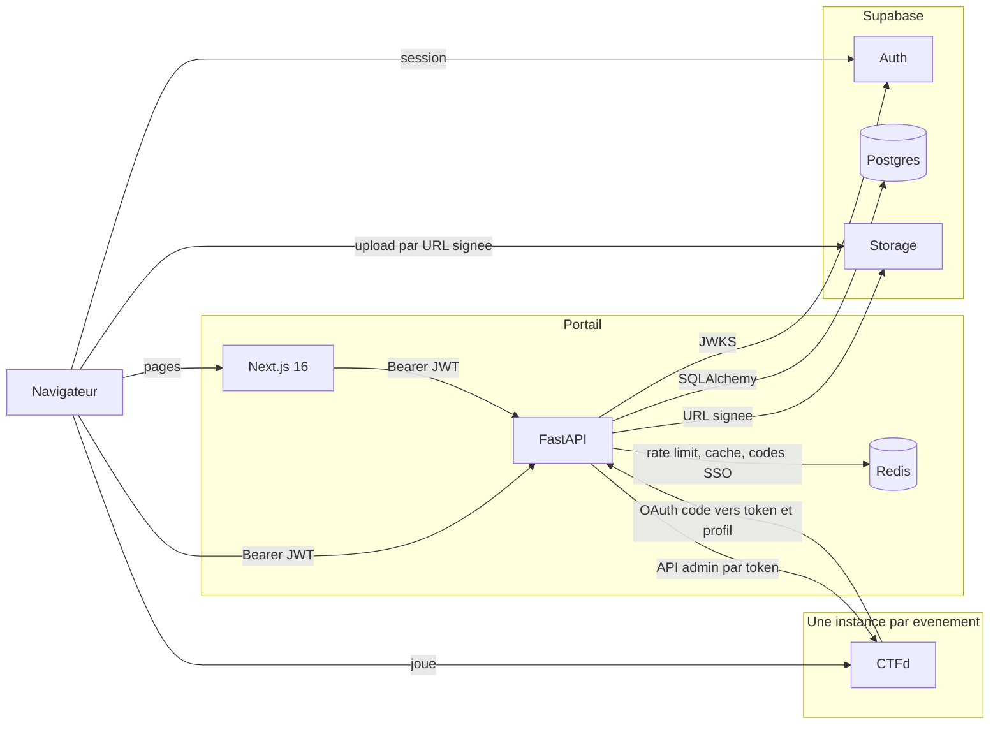
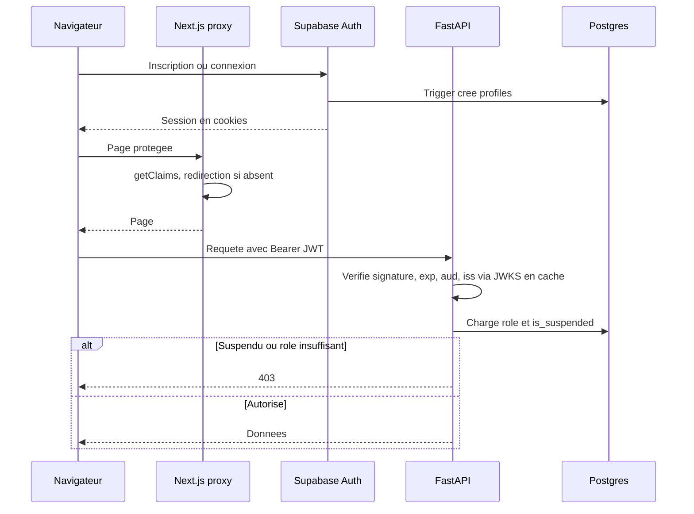
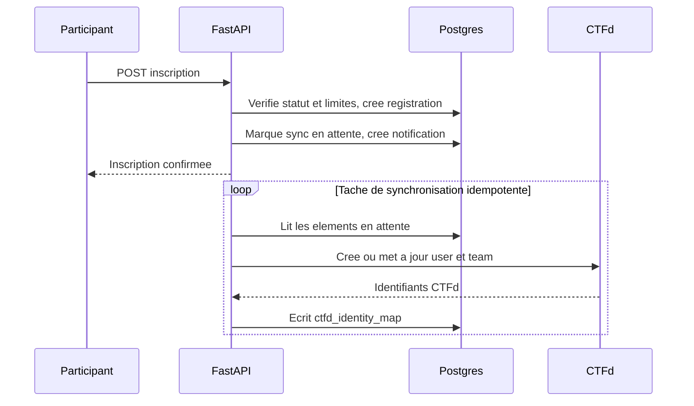
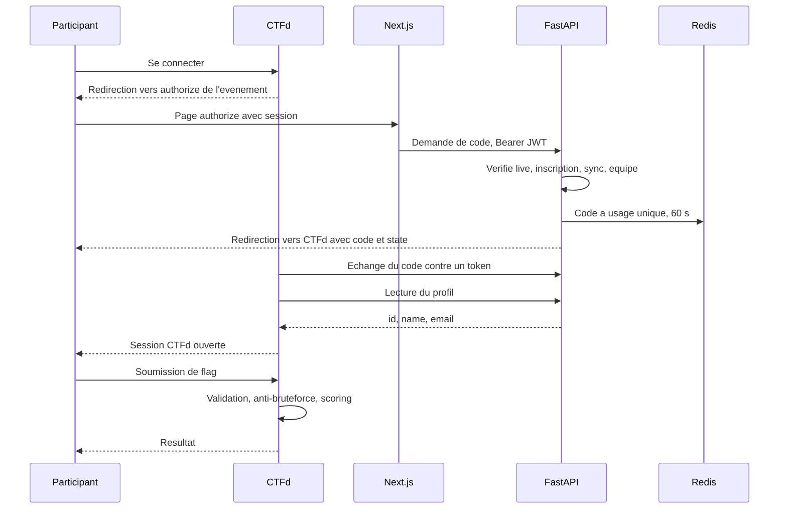

# Architecture MIABÉ CTF

Ce document suppose l'option A de l'[ADR 001](adr/001-ctfd-integration.md) : jeu sur l'instance CTFd, avec SSO depuis le portail. Elle est en attente de validation.

## 1. Vue d'ensemble

Responsabilités :

| Composant | Rôle | Ne fait jamais |
|---|---|---|
| Next.js | Rendu, session Supabase, confort de navigation | Lire ou écrire les tables métier |
| FastAPI | Toute la logique métier et les autorisations, seul client de CTFd | Voir ou journaliser un flag |
| Supabase | Comptes, base, fichiers | Porter la logique métier |
| Redis | Rate limiting, cache court, codes SSO à usage unique, verrous | Stocker une donnée durable |
| CTFd | Challenges, flags, soumissions, scoring | Gérer les comptes en direct : inscriptions fermées |

## 2. Authentification

## 3. Inscription à un événement et synchronisation CTFd

La synchronisation est idempotente grâce à `ctfd_identity_map` : un élément déjà associé est mis à jour, jamais recréé. Une erreur CTFd laisse l'élément en attente avec un compteur d'essais, sans faire échouer l'inscription.

## 4. Accès au jeu et soumission

Le flag ne quitte jamais CTFd. Le portail n'a aucune route de soumission.

## 5. Classement

FastAPI lit `GET /scoreboard` et met le résultat en cache Redis (TTL 15 s proposé), en conservant l'ordre renvoyé par CTFd. Le client interroge l'API toutes les 30 s pendant `live`. Le gel s'appuie sur le réglage `freeze` de CTFd.

## 6. Transitions automatiques

Une boucle `asyncio` lancée au démarrage de FastAPI applique les transitions basées sur les dates. Un verrou Redis garantit une seule exécution entre plusieurs workers, sans dépendance ajoutée. Chaque transition n'a lieu que si le statut attendu est encore en place, ce qui la rend idempotente, et elle est auditée.

## 7. Déploiement cible

Nginx termine le HTTPS, sert `miabectf.tg` vers Next.js et FastAPI, et route `event-xxxx.miabectf.tg` vers l'instance CTFd concernée. L'image CTFd est figée en version exacte (voir [VERSIONS.md](VERSIONS.md)).
